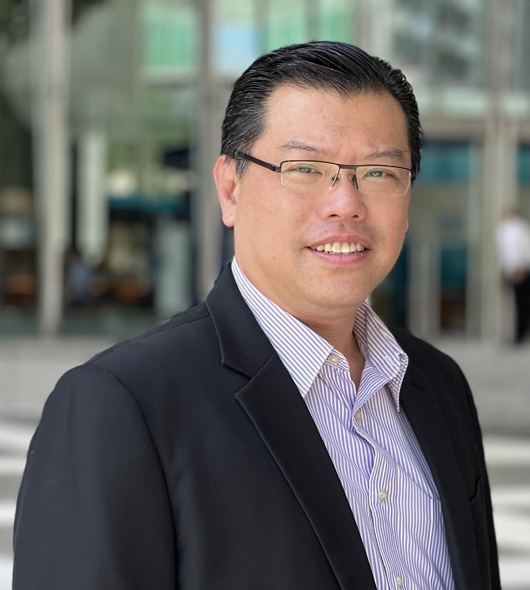

## **About AMBSAAS**

Established in November 2003, the Alliance Manchester Business School Alumni Association of Singapore (AMBSAAS) holds a unique distinction in our institution’s global history: it is one of only two alumni associations worldwide formed specifically for MBS graduates prior to the transition toward broader University of Manchester (UOM) alumni networks.

With over two decades of community, leadership, and impact behind us, having celebrated our landmark 20th anniversary, AMBSAAS continues to serve as a vital bridge for Manchester alumni across Singapore. Over the years, dedicated alumni have generously volunteered on the Council to host technical and academic evening talks, social gatherings, community fundraisers, the annual Manchester Day of Action, and high-value networking sessions. Many have also given back by sharing their experiences and insights with prospective and incoming MBA candidates, reinforcing the strong culture of mentorship that defines the Manchester journey.

As our alumni advance into leadership roles across diverse industries, their professional excellence continuously elevates the reputation of AMBS within the regional business landscape.

Today, AMBSAAS remains steadfast in fulfilling the core mission set out in its constitution:

* **Fostering Connection:** Building meaningful professional and social networks between alumni across all cohorts.
* **Supporting Institutional Growth:** Championing AMBS recruitment, outreach, and mentorship initiatives in Singapore.
* **Elevating Brand Prestige:** Enhancing the standing of AMBS through the active influence and leadership of our members in the wider community.

The true return on a Manchester MBA extends far beyond academic instruction. It lives in the lifelong camaraderie and trusted professional network built across generations of graduates. We warmly invite all Manchester alumni in Singapore to participate in upcoming AMBSAAS activities, share your expertise, and tap into the power of the global Manchester Network.

#### **Founding President**

Wayne Soo

Wayne Soo is the Founding President of The Alliance Manchester Business School Alumni Association of Singapore (AMBSAAS) in 2003\. After serving 3 terms as Honorary President, Wayne has been the Emeritus President of AMBSAAS since 2020\.

Professionally, Wayne has more than 25 years of auditing, financial and management consultancy experience initially with **Ernst & Young** (both in Malaysia and Singapore) before establishing his own firm in 2004, **Fiducia LLP**.

According to the Singapore Business Review, the firm is the 23rd largest accounting firm in Singapore as at December 2019 with over 60 professionals. In January 2020, Fiducia LLP became a full member of **Integra International**, a top 15 network of professional firms.

In his free time, Wayne provides mentorship to start-ups and students of the AMBS MBA programme.

### **Meet the Council Members**

*Editor note — this section is generated automatically on the website from LIVE → Pages → Team. Do not maintain member names, photos or roles here. Edit each member’s Team document instead. Use its Menu order field to control the display order. Changes appear after a successful content sync and website deployment.*
