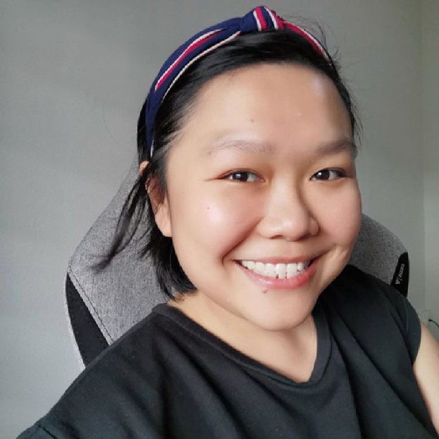

#### Honorary Deputy Secretary

Andrea brings a wealth of experience in events, marketing, and content creation to her role as the AMBSAAS Social Media Lead. A veteran of the Business Events industry, she previously led the Singapore headquarters of a leading agency.

Currently at Omnicom Media Group’s Content arm, Andrea is passionate about crafting compelling experiences, both in-person and digital to connect clients with their audiences – and likewise, for the AMBSAAS alumni. She is also a firm believer of giving back to the communities; through her role as a Mentor to tertiary students competing in the annual Singapore MICE Challemge, and coming off her own experiences in dealing with cancer and a brain tumour, she founded WABI – Working Adults Battling Illnesses; a support resource for those in the namesake.
