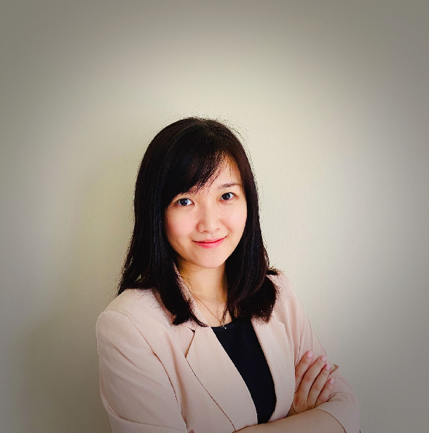

#### Empathy Lead, Council Member

Bai Lu is the senior consultant and business development for Global Digital Cities based in Singapore. She is responsible for driving Global Digital Cities business and building ecosystem partnership for all Dell customers across the globe, with her main focused countries in Asia. Before joining Dell in 2020, Bai Lu worked in the biggest Telecommunication Group in Southeast Asia for multiple roles such as enterprise architect and digital transformation lead. Her experiences provided her a holistic view in helping customers in their digital transformation journey.
