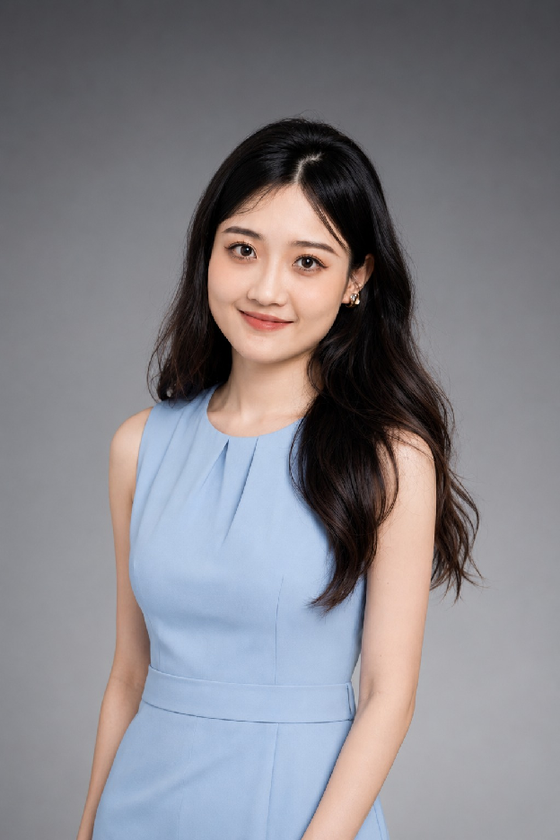

#### Student Representative, Jan 2025 Cohort

Sharon works across digital transformation, R\&D, IoT application development, and engineering projects in a range of industries. She enjoys connecting business and technology, working with stakeholders to turn technical ideas into practical solutions that deliver measurable outcomes. Her experience includes technology scoping, proposal development, market research, and cross-functional collaboration with regional and international teams. She is passionate about translating complex technical concepts into clear business value while driving innovation, process improvement, and operational excellence.

In her free time, she follows her curiosity wherever it leads, exploring new ideas, perspectives, and interests. She sees every fascination as a chance for discovery, growth, and the unexpected experiences that make life exciting.
